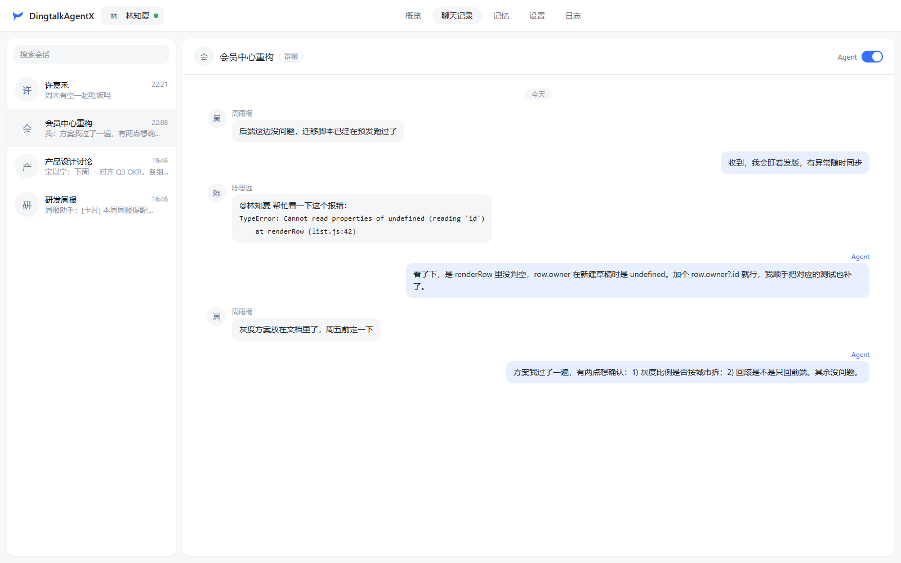
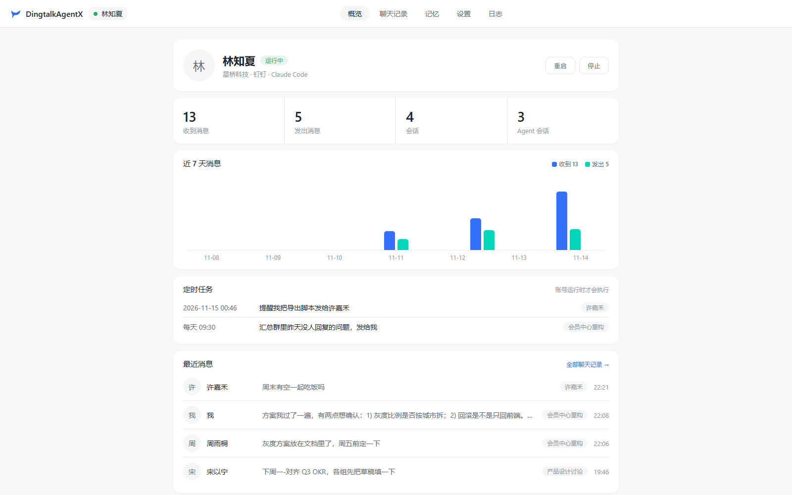

<div align="center">

[](requirements.txt)
[](https://github.com/cv-cat/DingtalkAgentX/stargazers)
[](#快速上手)
[](#为什么用-dingtalkagentx)

**简体中文**

</div>

DingtalkAgentX 让你的钉钉账号直连本地的 coding agent。扫码登录后，收到的消息交给本机的 Claude Code 或 Codex 处理，回复以你的账号发出。无需配置钉钉机器人。

## 快速上手

```bash
git clone https://github.com/cv-cat/DingtalkAgentX.git && cd DingtalkAgentX
pip install -r requirements.txt
python -m dingtalkx.web --port 8770    # 打开 http://127.0.0.1:8770 ，扫码添加账号
```

本机需要装好 Claude Code 或 Codex。扫码用钉钉 App 里的「扫一扫」。

## 控制台




账号、聊天记录、回复方式、agent 和触发规则都在这里管理，保存后立即生效。

## 为什么用 DingtalkAgentX

- **不用建机器人。** 直接用你自己的钉钉账号收发消息。
- **接本地的 agent。** Claude Code 或 Codex 都行，每个会话有自己的上下文。
- **多账号。** 每个账号独立目录，扫码即加。
- **数据在本地。** 登录凭证和消息都存在 `~/.dingtalkx/`。

## 数字人怎么工作

- **触发**：可按前缀、关键词、会话名单、发送者名单过滤，不满足的消息只入库不进队列；群聊可以要求只有 @你 才响应。
- **队列**：每个会话一个独立 FIFO 队列，逐条串行处理，不丢消息也不攒批。
- **上下文**：每条消息以 XML 交给 agent，带完整会话/发送者/内容；每个会话独立的持久 session，跨天接着聊。
- **回复**：agent 想回复就输出正文，由控制台代发；不想回就静默结束。
- **长期记忆**：`ding memory add` 记下的事全账号共享，每天可一键回顾最近 24 小时聊天自动整理。
- **定时任务**：`ding task add --in 30m "内容"`，到点后交回创建它的会话处理。

## 命令行

```bash
python ding.py memory add "内容"           # 长期记忆；ding memory 查看，edit、rm 修改和删除
python ding.py task add --in 30m "内容"    # 定时任务；也可以用 --at、--daily，ding task 查看
python ding.py chats                       # 列出本地会话
python ding.py messages <chat_id>          # 读本地消息记录
python ding.py send <chat_id> <text>       # 发消息
python cli.py qr                           # 扫码登录（CLI 方式）
python cli.py listen                       # 长链收推送
```

agent 以免确认模式运行，可以执行任意命令，只对信任的会话开启。

## 参与贡献

欢迎提交 Issue 和 Pull Request。

## Star 趋势

<a href="https://cvcat.site/star-history/svg?repos=cv-cat/DingtalkAgentX&type=Date">
  <picture>
    <source media="(prefers-color-scheme: dark)" srcset="https://cvcat.site/star-history/svg?repos=cv-cat/DingtalkAgentX&type=Date&theme=dark" />
    <source media="(prefers-color-scheme: light)" srcset="https://cvcat.site/star-history/svg?repos=cv-cat/DingtalkAgentX&type=Date" />
    
  </picture>
</a>

<details>
<summary>免责声明</summary>

<br>

- 仅供学习和研究使用，不得用于商业或违法用途。
- 通过钉钉客户端的内部协议工作，不是官方接口。请遵守钉钉的服务条款和当地法律。
- 自动收发消息可能触发风控，导致账号受限或被封，后果自负。
- 与钉钉及其运营方无关，名称和商标归各自所有者。

</details>
